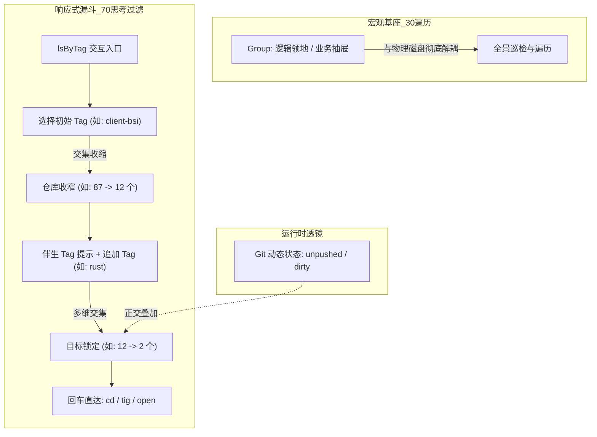

# Tag 响应式多维检索与工作流分析规范 (Living Spec)

> **【定位：永驻分析与设计规范 / Living Spec】**  
> **更新日期**：2026-10-12  
> **关联代码**：[`main.go`](file:///c:/Users/Lenovo/WorkBuddy/scan_git/main.go)（`lsByTag`, `cmdTag`）, [`internal/scope/scope.go`](file:///c:/Users/Lenovo/WorkBuddy/scan_git/internal/scope/scope.go), [`internal/state/state.go`](file:///c:/Users/Lenovo/WorkBuddy/scan_git/internal/state/state.go)  
> **前置规范**：[`docs/DESIGN-group-tag.md`](file:///c:/Users/Lenovo/WorkBuddy/scan_git/docs/DESIGN-group-tag.md), [`docs/USAGE.md`](file:///c:/Users/Lenovo/WorkBuddy/scan_git/docs/USAGE.md)

---

## 1. 业务场景与认知模型复盘

在日常多仓库治理中，开发者心智与操作行为存在极其明确的层次划分：



### 1.1 文件系统与概念空间的彻底解耦
* **物理目录是偶发与妥协的产物**：磁盘容量、多盘符（`C:`, `D:`, `E:`）、克隆历史会把仓库散落在各处；
* **用户拒绝文件系统与业务规则强绑定**：仓库在物理上放在哪里并不重要，重要的是它在用户心智中属于哪个项目；
* **结论**：`Group` 是绝对逻辑化的**互斥领地（Partitioning Drawer）**，与物理磁盘路径无关。

### 1.2 认知资源分配：30% 遍历 vs 70% 思考过滤
* **Group 承载约 30%~50% 的“粗粒度定位与大盘巡检”**：
  * 当用户敲入 `cd group:job` 时，主要目的是**遍历（Traversal）**；
  * 用户需要一个安全感十足的闭合边界，确认“工作业务域下所有的项目概览”。
* **Tag 承载约 70% 的“思考流与漏斗式精准过滤”**：
  * 在日常具体编码、调试、排查时，用户大脑中闪现的是**多维特征词**（如客户端名、技术栈、模块性质）；
  * 用户借助 Tag 进行连续的思维收敛（Faceted Narrowing），将视线从近百个仓库快速缩小到 1~3 个目标。

### 1.3 静态业务刻画 (Tag) vs 动态运行时客观状态 (Git Operational State)
* **寻找单目标**：通常由 `Group + Tag` 的语义正交组合完成；
* **寻找多目标批处理**（如“哪些仓库改了没提”、“哪些仓库有提交没推”）：
  * **不依赖静态 Tag**：因为“未推送”是高频波动的运行时属性，不应手工维护为静态标签；
  * **正交透镜叠加**：在由 Group/Tag 准备好的上下文基础上，一键叠加客观状态过滤（如 `ls --unpushed` / `ls --dirty`）。

---

## 2. 传统 CLI 在 Tag 场景下的阻力与失灵

在传统的命令行中，过滤标签通常形如：
```bash
igit list --tag=client-bsi,rust,sdk
```
这种模式在实际使用中存在三大断层：

1. **认知预载过重（High Cognitive Load）**：
   * 强制用户在敲下回车之前，在脑中完整回忆起系统里所有的标签命名；
2. **缺乏伴生反馈（Missing Companion Feedback）**：
   * 用户选了第一个标签后，不知道剩下的子集中**还伴随存在哪些有意义的标签**，只能靠猜；
3. **检索与行动断层（Search-Action Gap）**：
   * 命令行打印出匹配结果后，用户仍然需要手动复制仓库名或路径，再键入 `cd <路径>` 才能进入作业，打断了工作流。

---

## 3. `lsByTag` 响应式多维漏斗交互模型

### 3.1 核心状态机 (Faceted State Model)

```
[已选标签池 SelectedTags]   <- (追加 / 移除 / 重置)
        │
        ▼  交集计算 (Intersection)
[当前命中仓库 MatchedRepos]  <- (实时收缩 / 展开)
        │
        ▼  伴生频次聚合 (Companion Facets)
[伴生推荐标签 CandidateTags] <- (排除已选，按命中数降序展示)
        │
        ▼  目标直达 (Navigation Handoff)
[执行进入仓库 Action: cd / tig]
```

### 3.2 交互全流程时序原型

#### Stage 1: 初始启动
用户键入 `lsByTag`（或 `tag find` / `tag filter`）：

```text
igit [/ · 99 个仓库] > lsByTag

==================== 响应式标签漏斗检索 (lsByTag) ====================
[已选标签]: (暂无，显示全部仓库)

[可用伴生标签]:
  1) client-bsi (23)   2) rust (15)       3) flutter (18)
  4) sdk (12)          5) backend (30)    6) tools (8)

[当前命中仓库] (共 99 个，仅显示前 5 个):
  #1  algorithm-rs     [rust, sdk, client-bsi]
  #2  bsi-gateway      [client-bsi, backend]
  #3  flutter-shell    [flutter, client-bsi]
  #4  jenkins-runner   [tools, backend]
  #5  bsi-core-lib     [rust, sdk, client-bsi]
  ...

操作: 输入标签名/编号追加 | 输入 -<名> 移除 | 直接输入 #序号 进入仓库 | q 退出
> 1
```

#### Stage 2: 激活第一个标签 `client-bsi`（空间收敛至 23 个）
用户输入 `1`（对应 `client-bsi`），系统立即重算交集与伴生统计：

```text
==================== 响应式标签漏斗检索 (lsByTag) ====================
[已选标签]: [client-bsi]  (已从 99 个过滤至 23 个)

[伴生标签推荐] (仅展示当前 23 个仓库拥有的伴生标签):
  1) rust (6)          2) sdk (5)         3) flutter (4)
  4) backend (8)       5) legacy (2)

[当前命中仓库] (共 23 个，显示前 5 个):
  #1  algorithm-rs     [rust, sdk, client-bsi]
  #2  bsi-gateway      [backend, client-bsi]
  #3  flutter-shell    [flutter, client-bsi]
  #4  bsi-core-lib     [rust, sdk, client-bsi]
  #5  bsi-demo-app     [flutter, client-bsi]
  ...

操作: 输入标签名/编号追加 | 输入 -<名> 移除 | 直接输入 #序号 进入仓库 | q 退出
> rust
```

#### Stage 3: 激活第二个标签 `rust`（空间精准聚焦到 6 个）
用户键入 `rust`（或编号 `1`），多维交集计算生效，仓库缩减至 6 个，直接全量展开：

```text
==================== 响应式标签漏斗检索 (lsByTag) ====================
[已选标签]: [client-bsi] + [rust]  (空间收敛至 6 个)

[伴生标签推荐]:
  1) sdk (2)           2) cli (2)         3) embedded (2)

[命中仓库清单] (已全部展开):
  #1  algorithm-rs     [rust, sdk, client-bsi]       D:\work\algo
  #2  bsi-core-lib     [rust, sdk, client-bsi]       D:\work\core
  #3  bsi-flasher      [rust, embedded, client-bsi]  D:\work\flash
  #4  bsi-diag-cli     [rust, cli, client-bsi]       D:\work\diag
  #5  bsi-parser       [rust, client-bsi]            D:\work\parser
  #6  sensor-bridge    [rust, embedded, client-bsi]  D:\work\bridge

操作: 输入标签名/编号追加 | 输入 -<名> 移除 | 直接输入 #序号 进入仓库 | q 退出
> #2
```

#### Stage 4: 选定目标直接进入（就地接管 Scope）
用户键入 `#2`：
```text
-> 正在进入仓库 bsi-core-lib ...
作用域  / -> file:D:\work\core · 1 个仓库 (bsi-core-lib)
  [分支: main]  [未提交: 0]  [待推送: 2]  [Group: job]  [Tags: rust, sdk, client-bsi]

igit [repo:bsi-core-lib] > 
```
会话直接切入该单仓作用域，用户可立即开始敲击 `tig`、`status` 或 `open`。

---

## 4. 技术实现架构与接口契约

### 4.1 伴生聚合算法 (Faceted Aggregation)
```go
type FacetedResult struct {
    Matched []*state.Repo
    Facets  []TagFacet // 标签名 + 伴生出现频次，降序排列
}

func AggregateByTags(repos []*state.Repo, activeTags []string) FacetedResult
```
1. 过滤：遍历仓库，保留包含所有 `activeTags` 的仓库集；
2. 聚合：遍历匹配到的仓库，统计各标签的频次（排除已经在 `activeTags` 中的标签）；
3. 排序：按匹配仓库数降序排列，以便把最有效的收缩透镜排在前面。

### 4.2 交互指令映射 (Command Mapping)
* **追加标签**：
  * 输入纯数字 `1..N`：选择推荐伴生标签列表中的第 N 项追加；
  * 输入任意文本标签名：直接加入过滤器（支持模糊命中已存标签）。
* **移除标签**：
  * 输入 `-<标签名>` 或 `pop`：移除最后加入或指定的过滤标签，空间即时回弹。
  * 输入 `clear`：重置所有已选标签回全集。
* **直达仓库**：
  * 输入 `#<编号>` 或在命中数较少时直接输入命中行号：立即调用 `setScope(ctx, targetScope)` 并退出检索会话。
* **退出会话**：
  * 输入 `q` 或 `quit`：安全退出检索，保持原作用域不变。
